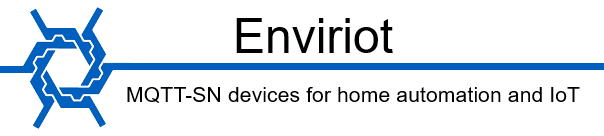
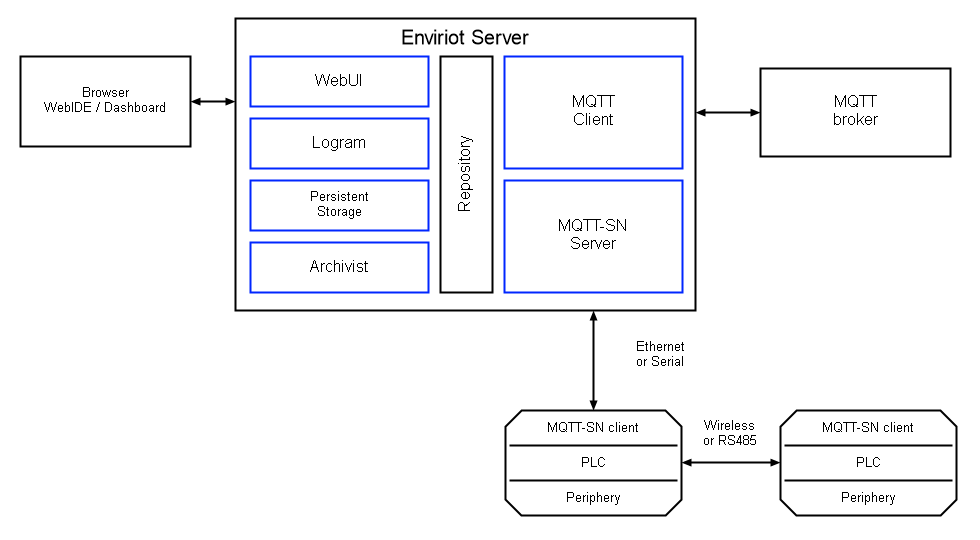

**Enviriot** is a low-code platform for device management and process automation.

A device, its settings, a sensor reading and a computed value are all represented the same
way — as topics in one tree — so the state of the whole system can be watched and changed in
real time. The control logic is drawn as visual diagrams (Logram), and everything else is
added by plugins: they attach devices and external systems, store data and history, and serve
the user interfaces. Plugins talk to each other only through the topic tree.

### Enviriot Server (bin/enviriot.exe)
- [x] Repository. The topic tree, the change queue and the engine tick
- [x] Runs as a console application or as a Windows service
- [x] Plugins discovered and loaded through MEF, started by priority
- [x] JavaScript runtime (NiL.JS) shared by user scripts and Logram blocks
- [x] XST import/export of any subtree

### plugin PersistentStorage (bin/PersistentStorage.dll)
- [x] State and manifest storage on LiteDB
- [x] Tree restored at startup, before the plugins that read it
- [x] Backup of the working database before it is opened

### plugin Archivist (bin/Archivist.dll)
- [x] Value history
- [x] Rollups over 5 minutes, an hour and a day
- [x] Retention policy
- [x] One query model for both charts and JavaScript

### plugin Logram (bin/Logram.dll)
- [x] JavaScript based Logram blocks
- [x] A synchronous processor unit
- [x] Published block [catalog](catalog/logram/)

### plugin MQTT-SN (bin/MQTT_SN.dll)
- [x] MQTT-SN Broker v1.2
- [x] ZeroConf. Search gateway & DHCP for devices
- [x] GPIO. Digital inputs/outputs, Analog inputs, PWM, UART.
- [x] TWI(I2C)
- [x] ScriptOnDevice

### plugin MQTT (bin/MQTT.dll)
- [x] MQTT Client v3.1 and v3.1.1

### plugin WebUI (bin/WebUI.dll)
- [x] WebIDE. Tree, Inspector, Logram editor, catalog and log, in the browser
- [x] Dashboard. Pages assembled by the user from ready-made components
- [x] pub/sub over WebSocket
- [x] Charts over the Archivist history
- [x] Dashboard access declared per topic; WebIDE limited to the local network

Both interfaces are served on port 80, falling back to 8080..8089 when it is taken:
unpack the release, start `enviriot.exe` and open `http://localhost/`.

Download | Link
---------|------
Enviriot Software | [Releases](https://github.com/enviriot/EnviriotSW/releases)
Node configurator | [v0.4.2006.2000](https://github.com/enviriot/enviriot.github.io/archive/NodeConf.zip)
Firmware | [v3.1.3](https://github.com/X13home/X13.devices)
Hardware | [Link](https://github.com/X13home/X13.hardware)

[Forum](https://www.ab-log.ru/forum/viewtopic.php?f=1&t=1325)
